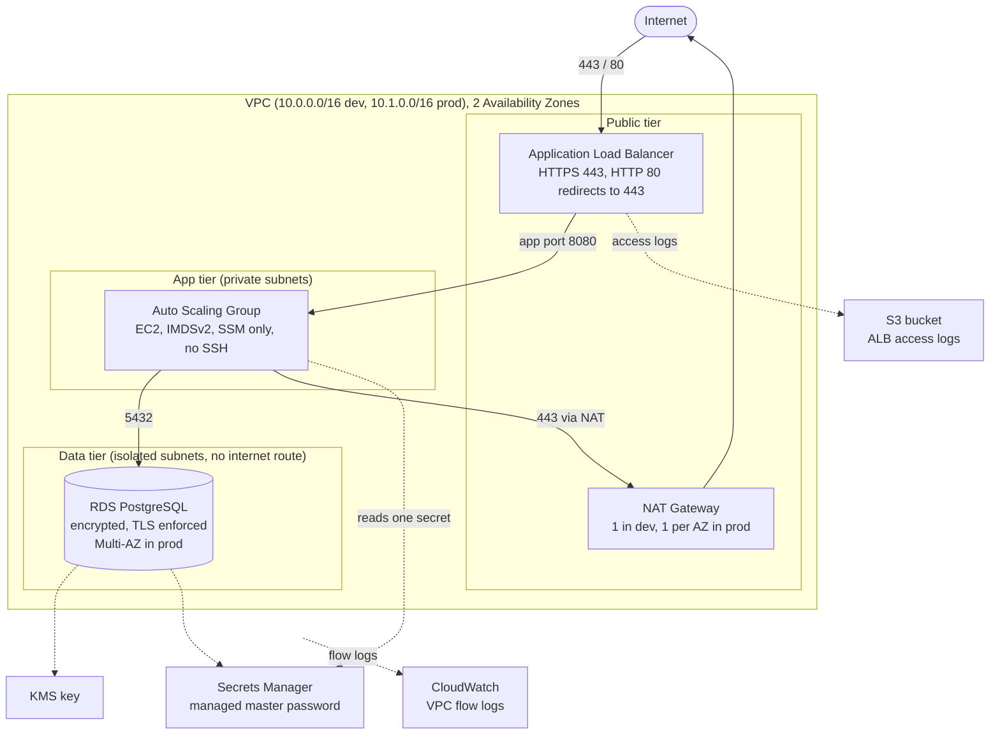

# AWS 3-Tier Architecture with Terraform

A production-style, multi-environment AWS 3-tier architecture written as reusable Terraform modules, with automated quality gates (formatting, linting, security scanning, generated docs).

> This project was built using mock credentials (see [Running it offline](#running-it-offline)). A real deployment needs an ACM certificate and a state bucket (see [Before a real deployment](before-a-real-deployment)).

| Environment | `terraform plan` result |
|---|---|
| dev | 59 to add, 0 to change, 0 to destroy |
| prod | 61 to add, 0 to change, 0 to destroy |

## Architecture



## Design decisions

| Decision | Why |
|---|---|
| **One root module per environment** (`environments/dev`, `environments/prod`) | Separate state files and blast radius. A mistake in dev cannot touch prod. |
| **Reusable child modules** (`modules/`) | Write once, use in both environments. Environments differ only by inputs. |
| **Chained security groups** | ALB accepts the internet, app accepts only the ALB, database accepts only the app. No IP ranges to maintain. |
| **No SSH, no key pairs** | Instances are managed through SSM Session Manager. There is no inbound admin port. |
| **IMDSv2 required** | Blocks the SSRF-to-credential-theft path. |
| **RDS-managed master password** | The password lives in Secrets Manager and never appears in code, Git or Terraform state. |
| **Least-privilege app role** | The app can read exactly one secret and use exactly one KMS key. |
| **Database subnets with no internet route** | The data tier cannot reach, or be reached from, the internet. |
| **Customer-managed KMS key with rotation** | Encrypts the database, its storage and the master secret. |
| **Remote S3 backend with native locking** | Shared, encrypted state with locking (`use_lockfile`, Terraform 1.10+), no DynamoDB table needed. |
| **Pinned Terraform and provider versions** | Reproducible builds. |

### Dev vs prod

| Setting | Dev | Prod |
|---|---|---|
| VPC CIDR | 10.0.0.0/16 | 10.1.0.0/16 |
| NAT gateways | 1 shared | 1 per AZ |
| ALB deletion protection | off | on |
| ALB log retention | 90 days | 365 days |
| Instances | t3.micro, 2 to 4 | t3.small, 2 to 6 |
| RDS class | db.t4g.micro | db.t4g.medium |
| RDS Multi-AZ | off | on |
| RDS deletion protection | off | on |
| RDS final snapshot | skipped | taken |
| Performance Insights | off | on |
| Flow log retention | 365 days | 365 days |

Dev is cost-optimized and disposable on purpose. Prod is the hardened reference.

## Repository structure

```text
.
├── modules/
│   ├── vpc/              # VPC, 3 subnet tiers, route tables, NAT, flow logs
│   ├── security-groups/  # chained ALB -> app -> database security groups
│   ├── alb/              # ALB, listeners, target group, access-log bucket
│   ├── compute/          # IAM role, launch template, Auto Scaling Group
│   └── rds/              # KMS key, PostgreSQL, managed secret
├── environments/
│   ├── dev/              # root module (calls the modules with dev values)
│   └── prod/             # root module (same modules, production values)
├── .pre-commit-config.yaml
├── .tflint.hcl
└── .checkov.yaml
```

Each module and environment has its own generated README (inputs, outputs, resources) produced by `terraform-docs`.

## Quality gates

Every commit runs through [pre-commit](https://pre-commit.com):

| Tool | Purpose |
|---|---|
| `terraform fmt` | Consistent formatting |
| `terraform validate` + `tflint` | Syntax, AWS-specific linting |
| `checkov` | Security scanning |
| `terraform-docs` | Auto-generated module documentation |

Checkov findings were triaged rather than ignored: cheap fixes were applied, and the rest were suppressed inline with a written reason (for example, ALB access-log buckets support SSE-S3 only, not KMS). Dev-only cost trade-offs are documented where they are suppressed.

## Running it offline

The AWS provider is configured with a `mock_mode` variable (default `true`) that supplies fake credentials and skips every call to AWS, so `validate` and `plan` work with no account.

```bash
cd environments/dev

# Local-only override that swaps the S3 backend for a local one (gitignored)
cat > backend_override.tf <<'EOF'
terraform {
  backend "local" {
    path = "terraform.tfstate"
  }
}
EOF

terraform init -reconfigure
terraform fmt -recursive
terraform validate
terraform plan
```

To run the quality gates:

```bash
pre-commit install
pre-commit run --all-files
```

## Before a real deployment

1. Create the S3 state bucket (versioning, encryption and public access block on) and set it in each `backend.tf`.
2. Set `mock_mode = false` and authenticate through SSO or OIDC.
3. Replace the placeholder `certificate_arn` with a real ACM certificate for your domain.
4. Replace the placeholder `access_logs_bucket_name` with a globally unique name.
5. Pin an exact PostgreSQL minor version instead of the major-version default.

## What I would add in production

- **AWS WAF** on the ALB.
- **Customer-managed KMS key** for the VPC flow log group, and an explicit KMS key policy.
- **CloudWatch alarms and a dashboard** (ALB 5xx, unhealthy hosts, RDS CPU and storage) with SNS notifications.
- **Route 53 and ACM** for the domain and certificate, with a failover design.
- **CI/CD** with GitHub Actions: `plan` on pull requests, `apply` on merge behind an approval, authenticating through GitHub OIDC.
- **VPC endpoints** for SSM and Secrets Manager to reduce NAT traffic and cost.
- **Cost estimate** with Infracost in pull requests. Note that NAT gateways are one of the largest fixed costs here, which is why dev uses a single one.

## Skills demonstrated

Terraform modules and multi-environment layout, AWS networking (VPC, subnets, NAT, route tables), security groups and least-privilege IAM, ALB, Auto Scaling, RDS, KMS and Secrets Manager, remote state design, and DevSecOps tooling (tflint, checkov, terraform-docs, pre-commit).

## 👩‍💻 Author

**Will Farid**

Cloud Engineer
---

## ⭐ Support

If you found this project useful, consider giving it a ⭐ on GitHub.
